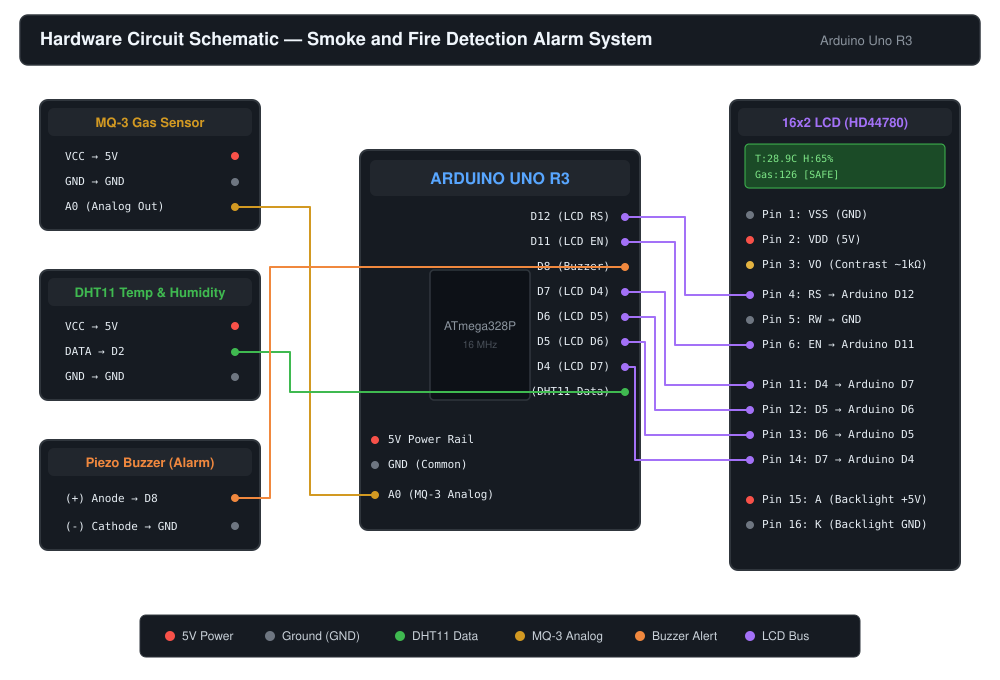
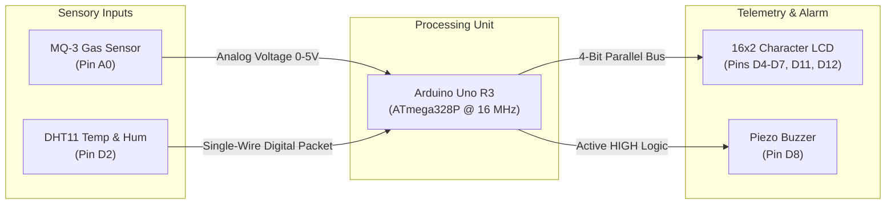

# Smart Smoke and Fire Detection Alarm System (Hardware)

[](https://www.arduino.cc/)
[](https://www.arduino.cc/reference/en/)
[](#hardware-components)
[](LICENSE)
[](#live-demonstration)

An autonomous, embedded fire and smoke early-warning system developed on the **Arduino Uno R3 (ATmega328P)** microcontroller platform. It continuously tracks hazardous smoke, combustible gas concentrations, ambient temperature, and relative humidity using an **MQ-3 gas sensor** and a **DHT11 sensor**, displaying real-time telemetry on an **LCD screen** and activating an acoustic **buzzer alarm** when safety limits are breached.

---

## 📽️ Live Demonstration

The system in action: real-time sensor sampling, automatic hazard evaluation, and immediate alarm triggering upon heat/smoke detection.

Live Demo link-https://youtu.be/V7BQAilHZ1E

---

## ⚡ Key Highlights & Features

- **Multi-Parameter Environmental Sensing:** Combines analog gas/smoke detection via an **MQ-3** sensor with digital temperature and humidity measurement via a **DHT11** sensor.
- **Dual Warning Feedback:**
  - **Acoustic:** Active high piezo buzzer triggers high-frequency audible warning.
  - **Visual:** 16x2 character LCD delivers real-time telemetry during safe operation and displays specific prioritized hazard alerts (`Fire Detected!`, `Smoke Detected`, `High Humidity!`).
- **Autonomous & Edge-Based:** Executes purely on the ATmega328P microcontroller with zero external internet dependencies for failsafe, continuous local operation.
- **Fail-Safe Sensor Monitoring:** Built-in validation checks for `NaN` (sensor disconnection or bus errors) to avoid false triggers.
- **Cost-Effective & Deployable:** Fabricated using accessible, low-power components ideal for residential apartments, college laboratories, server racks, and industrial storehouses.

---

## 🔌 Hardware Circuit Schematic

<p align="center">
  
</p>

### Circuit Block Architecture



---

## 🛠️ Bill of Materials (BOM)

| # | Component | Model / Spec | Purpose |
| :-: | :--- | :--- | :--- |
| **1** | Microcontroller Board | **Arduino Uno R3** (ATmega328P) | Core processing & I/O control |
| **2** | Gas / Smoke Sensor | **MQ-3** Semiconductor Gas Sensor | Detecting alcohol vapor, smoke & flammable gases |
| **3** | Temp & Humidity Sensor | **DHT11** Digital Sensor | Ambient environmental thermal monitoring |
| **4** | Display Module | **16x2 Character LCD** (HD44780) | Real-time telemetry & warning screen |
| **5** | Alarm Actuator | **Piezo Buzzer** (Active 5V) | High-decibel audible emergency alarm |
| **6** | Resistor Network | `1 kΩ` and `~300 Ω` resistors | LCD contrast bias divider connected to `VO` |
| **7** | Prototyping Board | Standard Breadboard (830 points) | Component mounting & power distribution rails |
| **8** | Wiring | Jumper Wires (Male-to-Male, Male-to-Female)| Interconnects between Arduino, sensors & display |
| **9** | Power Source | USB Cable / 9V-12V DC Adapter | 5V regulated system power supply |

---

## 📌 Pin Connection Reference

For full electrical details, see [docs/PINOUT_GUIDE.md](docs/PINOUT_GUIDE.md).

| Module | Pin on Module | Arduino Uno Pin | Note |
| :--- | :--- | :--- | :--- |
| **MQ-3 Gas Sensor** | `VCC`, `GND` | `5V`, `GND` | Common breadboard power rails |
| | `AO` (Analog Out) | `A0` | Analog ADC input |
| **DHT11 Sensor** | `VCC`, `GND` | `5V`, `GND` | Common breadboard power rails |
| | `DATA` | `Digital Pin 2` | Single-wire bidirectional serial bus |
| **Piezo Buzzer** | `(+)` Anode | `Digital Pin 8` | Active HIGH digital output |
| | `(-)` Cathode | `GND` | Common ground rail |
| **16x2 LCD Display** | `RS`, `Enable (E)` | `D12`, `D11` | Register select and latch enable |
| | `D4`, `D5`, `D6`, `D7` | `D7`, `D6`, `D5`, `D4` | 4-bit data bus |
| | `VSS`, `RW`, `K` | `GND` | Logic ground & backlight return |
| | `VDD`, `A` | `5V` | Logic power & backlight LED |
| | `VO` (Contrast) | Divider to `GND` | Biased via 1kΩ + 300Ω resistor combo |

---


## 🧠 Logic & Alarm Thresholds

The firmware reads each sensor once every second and tests for hazardous environmental anomalies:

$$\text{Hazard Condition} = (\text{MQ3 Value} > 200) \lor (\text{Temperature} > 35.0^\circ\text{C}) \lor (\text{Humidity} > 80\%)$$

| Environmental Parameter | Nominal Range | Threshold Limit | Action on Exceeding |
| :--- | :---: | :---: | :--- |
| **Gas / Smoke (MQ-3)** | $80 - 150$ | `> 200` | Buzzer **ON** + LCD: `"Smoke Detected"` |
| **Temperature (DHT11)** | $24^\circ\text{C} - 32^\circ\text{C}$ | `> 35.0°C` *(or > 40°C)* | Buzzer **ON** + LCD: `"Fire Detected!"` |
| **Relative Humidity (DHT11)** | $40\% - 70\%$ | `> 80%` | Buzzer **ON** + LCD: `"High Humidity!"` |
| **Normal / Safe State** | Within bounds | All Normal | Buzzer **OFF** + Live Telemetry Display |

For complete state transitions and circuit theory, refer to [docs/CIRCUIT_EXPLANATION.md](docs/CIRCUIT_EXPLANATION.md).

---

## 🚀 Getting Started & Flashing

### Prerequisites
1. Install the [Arduino IDE](https://www.arduino.cc/en/software) (v2.x or legacy v1.8.x).
2. Install the required Arduino libraries via the **Library Manager** (`Ctrl+Shift+I`):
   - **LiquidCrystal** by Arduino (Built-in standard library)
   - **DHT sensor library** by Adafruit
   - **Adafruit Unified Sensor** (dependency for DHT)

### Flashing Procedure
1. Clone or download this repository:
   ```bash
   git clone https://github.com/ritesh0w0/arduino-fire-smoke-detector.git
   cd arduino-fire-smoke-detector
   ```
2. Open `src/arduino_fire_smoke_detector.ino` in the Arduino IDE.
3. Select your board and port under **Tools**:
   - **Board:** `Arduino Uno`
   - **Port:** Select the COM port corresponding to your connected Arduino board.
4. Click **Verify** (`Ctrl+R`) to compile the sketch.
5. Click **Upload** (`Ctrl+U`) to flash the firmware onto the board.

---

## 🎬 Project Demo Video

The hardware demonstration video is available in 1080p 60FPS:
- **Direct Asset Download:** Download the full raw demonstration video from the [GitHub Releases](https://github.com/ritesh0w0/arduino-fire-smoke-detector/releases) section.
- *Alternatively, a short high-energy demonstration is embedded above as an animated GIF.*

---

## 👤 Author

- **Ritesh Kulakarni**
  - Department of Computer Science and Engineering
  - BMS Institute of Technology & Management (BMSIT&M), Bengaluru
  - GitHub: [@ritesh0w0](https://github.com/ritesh0w0)

---

## 📄 License

This project is licensed under the MIT License — see the [LICENSE](LICENSE) file for details.
