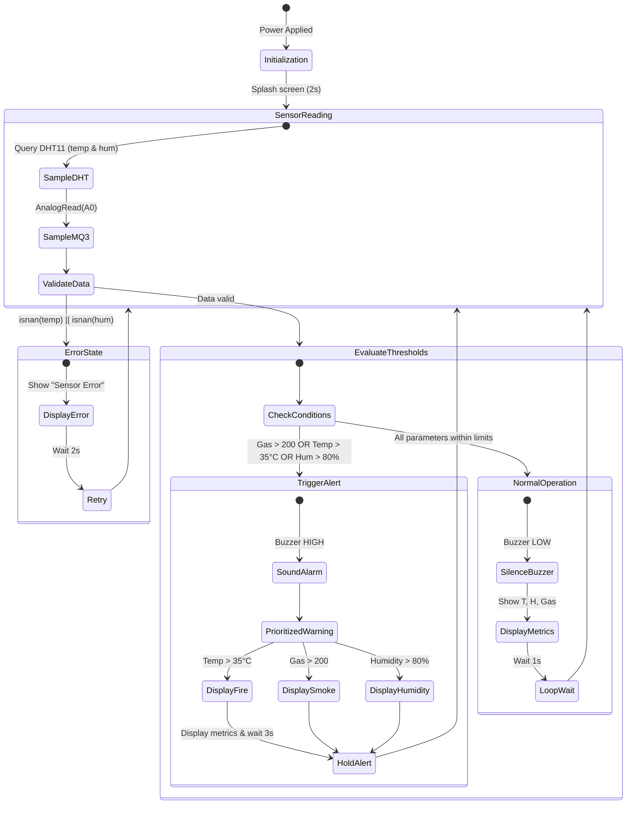

# Circuit Theory & System Working

This document provides a comprehensive breakdown of the hardware components, working principles, detection thresholds, and state transitions of the **Smart Smoke and Fire Detection Alarm System**.

---

## 1. System Block Diagram

```mermaid
flowchart LR
    subgraph SENSORS ["Sensing Layer"]
        MQ3["MQ-3 Gas Sensor\n(Analog Smoke / LPG)"]
        DHT["DHT11 Sensor\n(Ambient Temp & Humidity)"]
    end

    subgraph MCU ["Controller Layer"]
        Arduino["Arduino Uno R3\n(ATmega328P @ 16 MHz)"]
    end

    subgraph OUTPUTS ["Feedback Layer"]
        LCD["16x2 Character LCD\n(Visual Telemetry)"]
        Buzzer["Active Piezo Buzzer\n(Acoustic Warning)"]
    end

    MQ3 -->|Analog AO (0-1023)| Arduino
    DHT -->|Digital D2 (Single-Wire)| Arduino
    Arduino -->|4-Bit Bus (D4-D7, RS, EN)| LCD
    Arduino -->|Digital D8 (HIGH/LOW)| Buzzer
```

---

## 2. Component Analysis

### A. Microcontroller: Arduino Uno R3
- **Chip:** ATmega328P 8-bit AVR microcontroller running at 16 MHz.
- **Role:** Central processing hub. Continuously samples the analog input from the MQ-3 sensor and decodes single-wire digital packets from the DHT11, runs safety threshold verification algorithms, and controls telemetry outputs.

### B. Gas & Smoke Detection: MQ-3 Sensor
- **Sensing Material:** Tin dioxide ($SnO_2$).
- **Working Mechanism:** In clean air, the sensor has low electrical conductivity. When combustible gases, alcohol vapors, or smoke particulates are absorbed into the sensitive surface layer, the resistance drops proportionally to the gas concentration.
- **Reading:** Arduino reads the internal voltage divider using Analog Pin `A0`, returning an integer between `0` and `1023`.
- **Threshold:** A threshold of `> 200` represents the presence of elevated smoke or volatile gas.

### C. Temperature & Humidity Detection: DHT11
- **Working Mechanism:** Uses a resistive humidity-sensing component and an NTC temperature sensor, accompanied by an internal 8-bit microchip that outputs calibrated digital data.
- **Reading:** Single-bus digital transmission via pin `D2`.
- **Thresholds:**
  - Fire warning triggered at `> 35°C` (or `> 40°C` depending on ambient environment).
  - High humidity condition alerted at `> 80% RH`.

### D. Audio Feedback: Piezo Buzzer
- Connected to digital pin `D8`.
- Driven active-high (`digitalWrite(buzzerPin, HIGH)`) to generate a continuous warning tone whenever safety thresholds are breached.

### E. Visual Feedback: 16x2 HD44780 LCD
- Configured in 4-bit parallel mode to save microcontroller GPIO pins.
- Pinout uses control lines `RS (D12)` and `Enable (D11)` with data lines `D4 (D7)`, `D5 (D6)`, `D6 (D5)`, `D7 (D4)`.
- Displays real-time metrics during safe operation and descriptive alerts during hazard states.

---

## 3. State Machine & Execution Flow



---

## 4. Prioritization Hierarchy

When multiple hazard conditions occur simultaneously, the system prioritizes display warnings as follows:
1. **Fire Detected:** Highest priority condition (`temp > TEMP_THRESHOLD`).
2. **Smoke Detected:** Secondary priority condition (`mq3Value > GAS_THRESHOLD`).
3. **High Humidity:** Environmental anomaly alert (`hum > HUMIDITY_THRESHOLD`).
